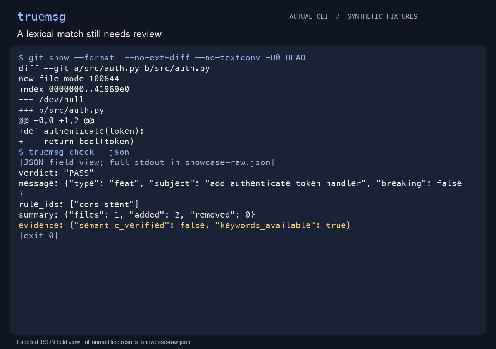

<p align="center"><strong>English</strong> &nbsp;·&nbsp; <a href="README.zh-CN.md">简体中文</a></p>

<p align="center"></p>
<h1 align="center">truemsg</h1>
<p align="center"><strong>Does the message describe this change?</strong></p>
<p align="center">Compare commit and PR wording with paths, declarations, and limited lexical signals. Surface claims that deserve a second look, without a model or server.</p>
<p align="center"><a href="#quick-start">Quick start</a> &nbsp;·&nbsp; <a href="#usage">Usage</a> &nbsp;·&nbsp; <a href="docs/guide.md">Guide</a> &nbsp;·&nbsp; <a href="CONTRIBUTING.md">Contribute</a></p>

<p align="center"><a href="assets/demo.gif" title="Open the full-size usage demonstration"></a></p>

An auth change with an auth message, followed by a tests-only change claiming a new feature. [Recording and reproduction](assets/MEDIA.md).

## Why truemsg?

A title says a payment feature was added, but the patch only adds a test file. That is a useful reason to revisit the wording or inspect the evidence. truemsg provides that prompt; PASS means no rule conflict was found, not that the message is semantically true.

## Quick start

Python 3.11+ and Git 2.31+. Installation may download dependencies; analysis runs offline. The disposable demo checks expected PASS and FAIL cases.

Clone the published source and install it in an isolated environment:

```bash
git clone --branch noah/truemsg https://github.com/LucasXlab/truemsg.git
cd truemsg
python3 -m venv .venv
. .venv/bin/activate
python -m pip install .
python scripts/demo.py
```

The demo checks one matching auth change and one tests-only feature claim. It expects `PASS`/exit `0` and `FAIL`/exit `1`, respectively; these are rule outcomes, not semantic judgments.

Now open your own repository while keeping the environment active:

```bash
cd /absolute/path/to/your/repo
truemsg check --ref HEAD --language en
```

For each finding, inspect the selected diff and either improve the message or document why the rule does not apply. Empty comparisons, including all-ignored changes, produce `WARN` with `score: null`; `--fail-on warn` makes that exit `1`. English is the default output language; `--language zh-CN` translates findings and terminal labels. **Matching still uses ASCII keywords**, so a Chinese-only message requires manual review.

## Usage

### Choose the comparison

```bash
truemsg check --json
truemsg check --ref HEAD~1 --json
truemsg check --pr --base main --head feature --title 'feat(auth): add authenticate'
```

The first command checks HEAD's own message and diff. A selected range is one aggregate comparison, not a per-commit audit. `A..B` uses endpoints; `A...B` uses the merge base.

### Add a local policy

```toml
fail_on = "warn"
ignore = ["generated/*"]
```

Save this as `truemsg.toml`. An invalid explicit config is an error. FAIL exits `1`; WARN does so only at the warn threshold. Input, history, or parsing errors exit `2`. The guide covers the optional pre-push hook and composite action.

## Scope

Keywords currently use ASCII; unsupported wording and non-text changes can leave insufficient evidence. Rules do not prove semantic consistency. Reports may contain subjects and filenames; inspect them before sharing. No tests or remote fetch are run automatically.

See the [usage guide](docs/guide.md) for more examples, exact parameters, and technical boundaries.

## Contributing

Start with [CONTRIBUTING.md](CONTRIBUTING.md). Use synthetic reproductions and report the validation you actually ran.

[MIT License](LICENSE) · [简体中文](README.zh-CN.md)
