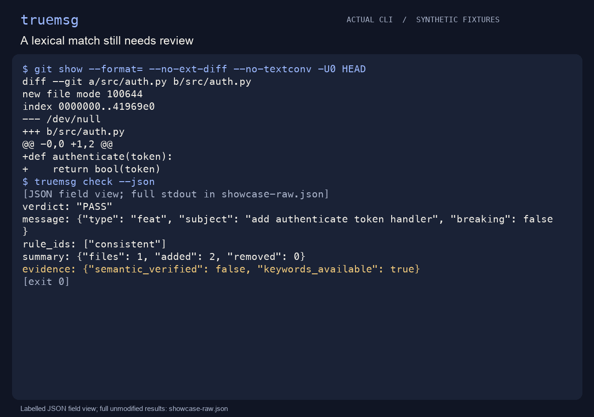

<p align="center"><a href="README.md">English</a> &nbsp;·&nbsp; <strong>简体中文</strong></p>

<p align="center"></p>
<h1 align="center">truemsg</h1>
<p align="center"><strong>提交说明，说的是这次改动吗？</strong></p>
<p align="center">对照提交或 PR 的文字、改动路径、声明与有限词法信号，找出值得复核的宣称；无需模型或服务器。</p>
<p align="center"><a href="#快速开始">快速开始</a> &nbsp;·&nbsp; <a href="#实际使用">使用方式</a> &nbsp;·&nbsp; <a href="docs/guide.zh-CN.md">完整手册</a> &nbsp;·&nbsp; <a href="CONTRIBUTING.md">参与贡献</a></p>

<p align="center"><a href="assets/demo.gif" title="点击查看原尺寸演示"></a></p>

先提交认证代码与相关说明，再让“新增功能”的说明对照只改测试的 diff。 [录制与复现](assets/MEDIA.md)。

## 为什么需要它

标题说新增支付功能，补丁却只添加了测试文件：这时应重看说明，或解释改动。truemsg 提供复核线索；PASS 只表示规则未发现冲突，不证明说明在语义上真实。

## 快速开始

需要 Python 3.11+ 和 Git 2.31+。安装可能下载依赖，分析离线运行；临时演示会核对预期 PASS / FAIL。

```bash
python3 -m venv .venv
.venv/bin/python -m pip install .
.venv/bin/python scripts/demo.py
```

## 实际使用

### 先选对比较范围

```bash
truemsg check --json
truemsg check --ref HEAD~1 --json
truemsg check --pr --base main --head feature --title 'feat(auth): add authenticate'
```

先激活 `.venv`。第一条检查 HEAD 自身的说明与 diff；range 只作一次聚合比较，不是逐提交审计。`A..B` 比较端点，`A...B` 使用共同祖先。

### 加入本地策略

```toml
fail_on = "warn"
ignore = ["generated/*"]
```

保存为 `truemsg.toml`。显式配置损坏会报错；FAIL 退出 `1`，WARN 仅在 warn 阈值下退出 `1`；输入、历史和解析错误退出 `2`。可选 pre-push hook 与 composite action 见手册。

## 适用边界

目前关键词使用 ASCII，中文说明与非文本变更可能证据不足，不会冒充已完成语义验证。报告可能包含标题与文件名，分享前需检查；工具不会自动运行项目测试或 fetch。

详细参数、更多演示和技术边界见[中文使用手册](docs/guide.zh-CN.md)。

## 参与贡献

请从[贡献指南](CONTRIBUTING.md)开始，使用合成输入复现问题，并报告实际执行的验证。

[MIT 许可证](LICENSE) · [English](README.md)
