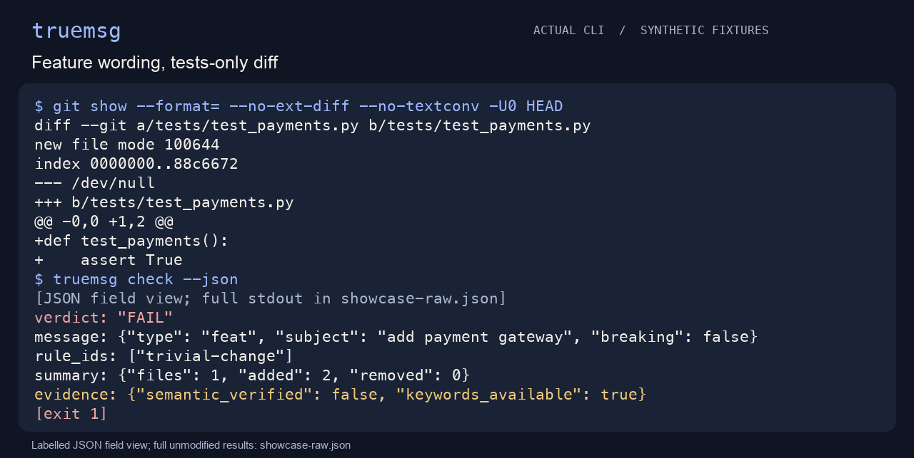
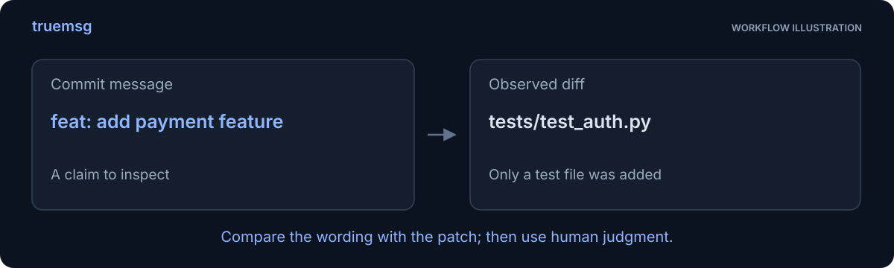
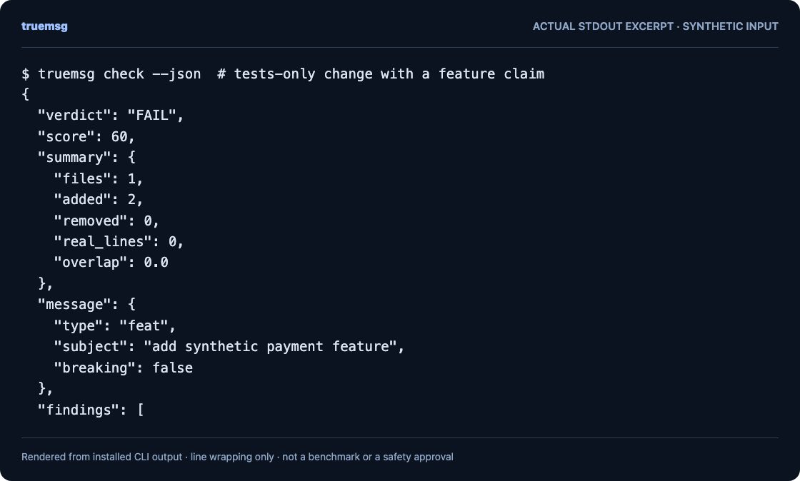
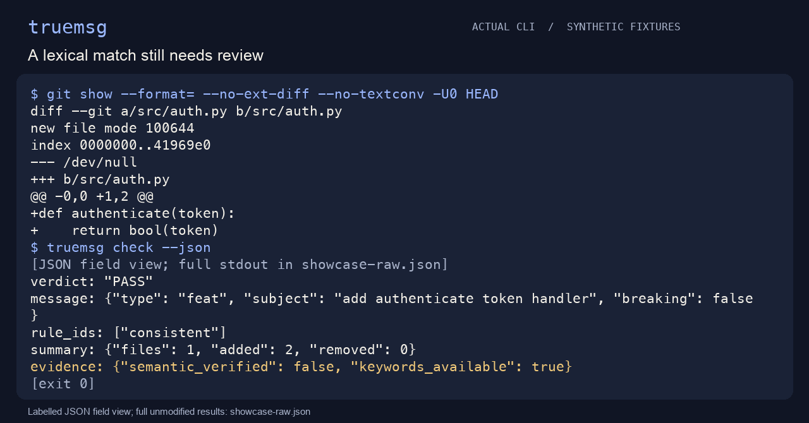
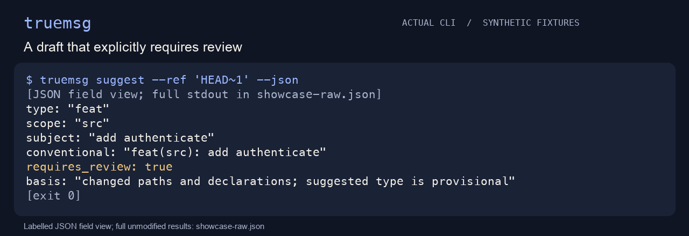
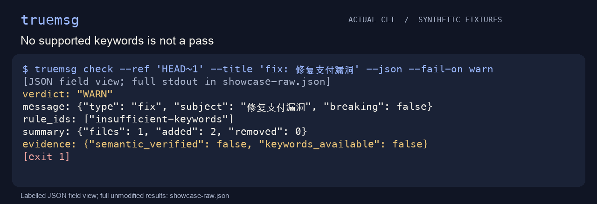
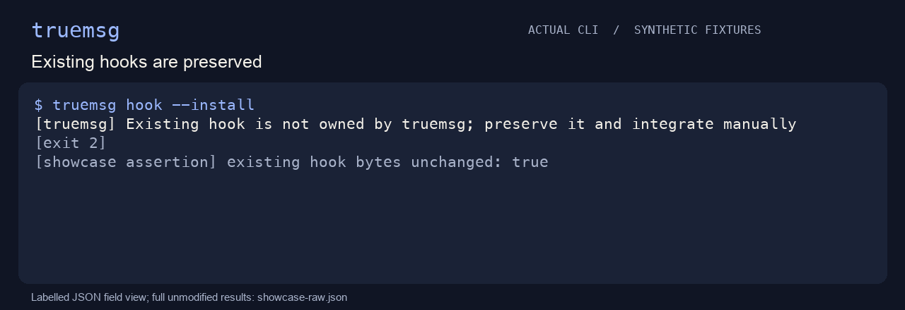
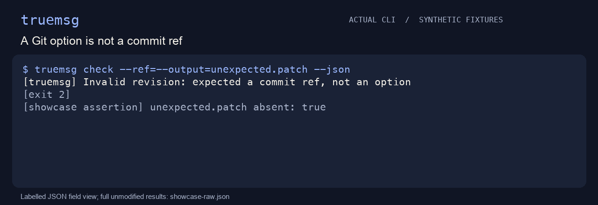
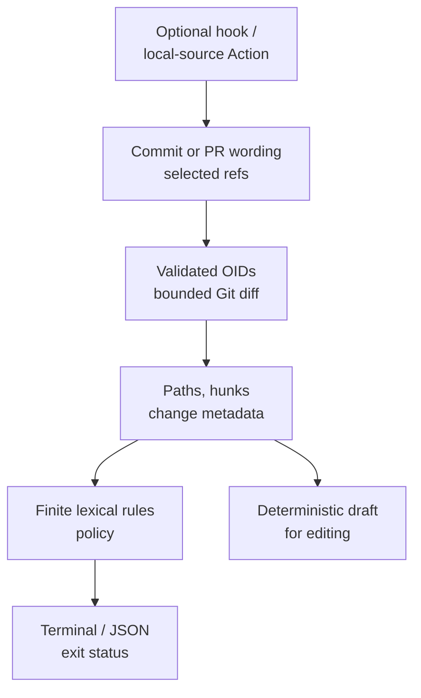

**English** · [简体中文](guide.zh-CN.md)

<p align="center"></p>
<h1 align="center">truemsg</h1>
<p align="center"><strong>Find commit claims that deserve a second look.</strong></p>
<p align="center">
  
  
  
  
  
</p>

Compare commit or PR wording with changed paths, declarations, and limited lexical signals. Get a review prompt when the claim and observable change appear out of step—without a model or server.

[简体中文](../README.zh-CN.md) · [Quick start](#quick-start) · [Choose a review](#choose-the-review-you-actually-mean) · [Policy](#policy) · [Hook](#optional-pre-push-hook) · [MIT](../LICENSE)


The GIF is a real local recording rendered as labelled JSON field views. Reading holds replace execution timing; [full results, cast and regeneration](../assets/MEDIA.md) remain available.

## A feature title, but only tests changed

The included demo first commits an authentication function with a related feature message. It then commits only a test file while claiming a payment feature. truemsg produces a PASS for the first fixture and a FAIL for the second, using its actual lexical rules.

This makes a useful review conversation: correct the title, explain the change, or inspect the rule's evidence. **PASS means no rule conflict was found, not that the description is semantically true.** WARN and FAIL also require judgment; supported keywords are currently ASCII.



## Why look beyond wording?

| Start with | What you can inspect | What it does not establish |
|---|---|---|
| A message-format check | Whether the title follows a convention | How that wording relates to the selected diff |
| A Git diff | Changed files, hunks and metadata | Whether the description explains those changes |
| truemsg | Limited, inspectable path/declaration/keyword signals | Semantic truth, code correctness or an accuracy guarantee |



## Quick start

From this source checkout, with Python 3.11+ and Git 2.31+:

```sh
python3 -m venv .venv
.venv/bin/python -m pip install .
.venv/bin/python scripts/demo.py
```

The demo creates and removes a synthetic Git repository. Installation may download build/runtime dependencies; analysis itself works offline. This source is prepared for the LucasXlab organization; no package-registry release or remote CI result is claimed.

<details>
<summary>See actual CLI output</summary>



Rendered from a real stdout excerpt, not invented output. A JSON excerpt may be incomplete. [Text excerpt](../assets/readme-demo.txt) · [Reproduce](../docs/readme-demo.md).

</details>

## Choose the review you actually mean

After activating `.venv`, choose a comparison deliberately:

| Review | Command | Scope |
|---|---|---|
| The last commit | `truemsg check --json` | HEAD's message and its own diff |
| One earlier commit | `truemsg check --ref HEAD~1 --json` | That commit, not the current working tree |
| A PR | `truemsg check --pr --base main --head feature --title 'feat(auth): add authenticate'` | Merge-base comparison with the supplied title |
| A draft suggestion | `truemsg suggest --ref HEAD --json` | A deterministic starting point that still needs editing |

`--range A..B` checks one aggregate endpoint diff; `A...B` uses the merge base. Neither means “check every commit in the range.” Use the hook's per-commit behavior when that is your intent.



### Draft, then edit

`suggest` produces a deterministic starting point from visible paths and declarations. Its suggested type is provisional and the JSON explicitly says `requires_review: true`.



### Missing evidence stays visible

A Chinese/no-keyword message cannot be verified by the ASCII overlap rules. It gets an insufficient-evidence warning rather than a positive semantic claim. `--fail-on warn` makes that warning a nonzero exit.



## Usage

```sh
truemsg check                            # HEAD message and its own diff; root commits supported
truemsg check --ref HEAD~1 --json         # one commit; merge commits use first-parent diff
truemsg check --range main..feature      # endpoint diff; message defaults to feature tip
truemsg check --range main...feature     # merge-base diff, explicitly selected
truemsg check --pr --base main --head feature --title 'feat(auth): add authenticate'
truemsg suggest --ref HEAD --json        # deterministic draft, needs editing
```

`--title`/`--body` can replace the message. A range is one aggregate comparison, not verification of every commit in it. PR mode defaults to merge-base comparison; `--range` can explicitly select another range and cannot be combined with `--base/--head`. Missing refs/history, malformed patches and invalid configuration return **2**; rule FAIL returns **1**; WARN returns **1** only with `fail_on = "warn"` or `--fail-on warn`. Success/allowed WARN returns **0**. Shallow history may need a deeper local checkout; truemsg does not fetch it. Partial/promisor clones are rejected before object lookup to prevent implicit fetching.

ASCII keywords are currently used for overlap. Messages without supported keywords, and binary/mode/symlink/submodule changes, produce insufficient-evidence warnings. Configuration changes are not assumed harmless. File/declaration heuristics are not an AST or semantic proof. Very large inputs are rejected instead of silently truncated (8 MiB per Git output stream, 15 seconds per Git call).

## Policy

`truemsg.toml` in the repository root is optional. An explicit `--config path` must exist and parse correctly; malformed or unsupported policy never silently falls back. CLI `--fail-on` overrides the file, then defaults apply.

```toml
fail_on = "warn"
ignore = ["generated/*"]
[thresholds]
docs_with_code_lines = 40
min_keywords_for_overlap = 2
overlap_low = 0.34
overlap_high = 0.6
large_diff_lines = 200
```

Ignore patterns exclude files from rule analysis; Git still supplies the selected diff. JSON lists the supplied changes and marks semantic verification false. Reports can contain local subjects, paths and keyword excerpts; review before sharing. No report is automatically uploaded.

## Optional pre-push hook

```sh
truemsg hook --install
truemsg hook --uninstall
```

Installation refuses foreign or modified hooks, follows Git's configured hook directory (including linked worktrees), and never overwrites an existing hook. Uninstall removes only the exact owned script. Keep `truemsg` on PATH when pushing. The hook reads Git's actual ref updates and checks each newly introduced commit with the warn threshold. New branches compare against locally known remote refs; deletions introduce no commits. Missing advertised history or more than 1,000 commits fails closed; no remote fetch is performed. This opt-in gate is a reminder, not an approval or authentication system.



## GitHub Action

The local composite action installs its own source, treats inputs as data and supports `range`, `working-directory` and `fail-on`. Use a full-history checkout when comparing refs. The prepared CI includes a synthetic local-action smoke check; remote runs remain unverified until publication.

The shared Git reader also rejects option-like refs; this CLI capture shows that boundary, not a remote Action run.



## Architecture



The diagram shows data flow, not an accuracy claim. There is no model or background server in this path.

## Development

`make dev` creates a project venv and installs developer tools. `make check` runs lint, format and all tests with a 70% whole-package coverage floor. `make build` creates wheel/sdist; `make demo` runs the real synthetic CLI demo. The CI matrix is prepared for Python 3.11–3.13 on Linux; local Builder results only cover the actual host recorded separately.

## Security and limits

Git calls reject option-like revisions, resolve commit OIDs, disable textconv/external diff, and avoid user-level Git configuration. This is not a sandbox for an arbitrarily malicious Git executable or operating system. Ignore unsupported data deliberately; do not treat an incomplete/error run as clean. No regex tool can guarantee removal of personal data from reports. MIT copyright remains preserved.

## Roadmap

- Reviewed language tokenizers and clearer localization.
- Broader real-world precision evaluation using shareable examples.
- More explicit policy profiles.

No precision/recall or Star-growth claim has been measured.

## Contributing

See [CONTRIBUTING.md](../CONTRIBUTING.md). Development has used AI assistance. Please bring reproducible synthetic examples, keep private diffs out of reports, and preserve the distinction between a rule signal and a semantic judgment.

## License

[MIT License](../LICENSE).
