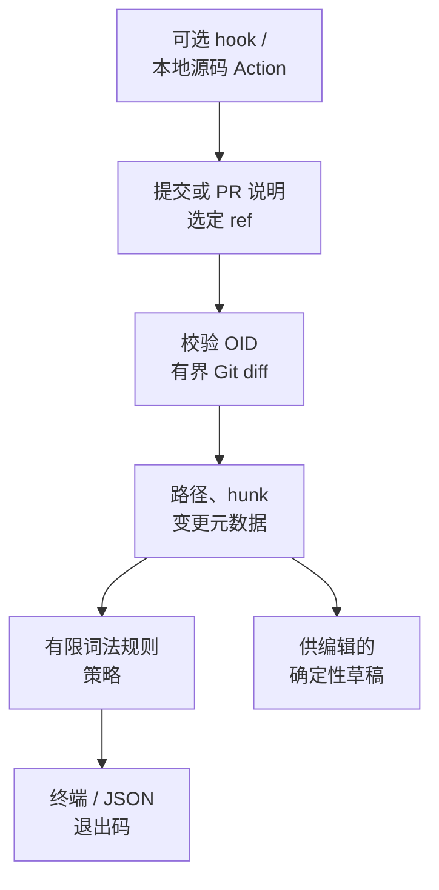

[English](guide.md) · **简体中文**

<p align="center"></p>
<h1 align="center">truemsg</h1>
<p align="center"><strong>找到值得再看一眼的提交宣称。</strong></p>
<p align="center">
  
  
  
  
  
</p>

对照提交 / PR 的文字、改动路径、声明和有限词法信号，提示表达与可见改动可能不一致的地方。无需模型或服务器。

[English](../README.md) · [快速开始](#三条命令运行) · [选择审阅范围](#选择真正要审阅的范围) · [策略](#配置策略) · [MIT](../LICENSE)


GIF 来自真实本地录制，采用明确标注的 JSON 字段视图。停留时间为方便阅读而延长；[完整输出、原 cast 与复现方法](../assets/MEDIA.md) 可核对。

## 标题说新增功能，却只改了测试

内置演示先提交认证函数与相关 feature 消息，再只提交测试文件，却声称新增支付功能。真实 CLI 对第一组输出 PASS，对第二组输出 FAIL，依据是当前词法规则。

接下来可以纠正标题、解释实际变化，或复核规则证据。**PASS 只表示未发现规则冲突，不证明说明在语义上真实。** WARN / FAIL 同样需要判断；目前支持的重合关键词是 ASCII。


## 为什么同时看说明与 diff？

| 起点 | 能查看什么 | 不能据此确认什么 |
|---|---|---|
| 提交格式检查 | 标题是否符合约定 | 文字与选定 diff 的关系 |
| Git diff | 文件、hunk 和元数据 | 说明是否解释了这些变化 |
| truemsg | 有限的路径、声明、关键词信号 | 语义真实、代码正确或准确率保证 |


## 三条命令运行

在源码目录，准备 Python 3.11+ 与 Git 2.31+：

```sh
python3 -m venv .venv
.venv/bin/python -m pip install .
.venv/bin/python scripts/demo.py
```

演示使用自动清理的合成 Git 仓库。安装可能下载构建/运行依赖，分析过程离线。尚不声称已在包注册表发行或远端 CI 通过。

<details>
<summary>查看真实 CLI 输出节选</summary>


图像由真实 stdout 节选排版生成，不是虚构输出。JSON 节选可能不完整。[文本节选](../assets/readme-demo.txt) · [复现方式](../docs/readme-demo.md)。

</details>

## 选择真正要审阅的范围

激活 `.venv` 后：

| 任务 | 命令 | 范围 |
|---|---|---|
| 最新提交 | `truemsg check --json` | HEAD 的消息及自身 diff |
| 更早的一个提交 | `truemsg check --ref HEAD~1 --json` | 该提交，不是当前工作树 |
| PR | `truemsg check --pr --base main --head feature --title 'feat(auth): add authenticate'` | merge-base 比较和传入标题 |
| 起草建议 | `truemsg suggest --ref HEAD --json` | 确定性的待编辑初稿 |

`A..B` 是聚合端点 diff；`A...B` 使用共同祖先。两者都不是逐提交核验。需要逐提交检查时，应理解下方 hook 的实际行为。


### 草稿仍需编辑

`suggest` 根据可见路径和声明给出确定性的起点；建议类型只是暂定值，JSON 明确包含 `requires_review: true`。


### 没有证据时直接说明

中文或没有受支持关键词的消息不会被 ASCII 重合规则验证。它会得到证据不足的 WARN；`--fail-on warn` 可让这一提醒返回非零。


## 配置策略

根目录的 `truemsg.toml` 可选；显式 `--config` 必须存在且可解析。CLI 的 `--fail-on` 优先于文件。

```toml
fail_on = "warn"
ignore = ["generated/*"]
[thresholds]
docs_with_code_lines = 40
min_keywords_for_overlap = 2
overlap_low = 0.34
overlap_high = 0.6
large_diff_lines = 200
```

ignore 排除规则分析中的文件，Git 仍提供所选 diff。JSON 保留所供变更并标明未做语义验证。报告可能包含本地标题、路径与关键词，分享前检查。

## 范围与限制

`check` 默认检查 HEAD 自身（支持首提交；merge 使用第一父节点）。`--ref` 选单提交，`--range A..B` 比较两端，`A...B` 比较 merge-base；range 使用 B 的消息或明确 `--title`，不是逐提交核验。PR 模式默认 merge-base；显式 range 不能与 base/head 混用。中文或没有受支持关键词的消息会提示证据不足；二进制、权限、符号链接及 submodule 改动也需人工检查。配置文件不被当作无行为变化。

退出码 2 表示参数/读取/解析/配置或 Git 错误，1 表示 FAIL 或 warn 阈值下的 WARN，0 表示无门禁冲突。可选 `truemsg.toml`；显式缺失/损坏配置会报错，命令行 fail-on 优先。Git 单次超时15秒，每个输出流限8MiB，超限不会冒充空 diff。partial/promisor clone 在查找对象前被拒绝，防止隐式取回远端对象。

可选 `hook --install/--uninstall` 尊重现有钩子，仅卸载本工具精确脚本，支持 worktree。它从真实 pre-push 输入检查新提交，缺历史或超过1000提交时失败，绝不自动 fetch。报告可能包含本地标题和文件名，公开前应人工复核，不会自动上传。

## 可选 hook 与 Action

```sh
truemsg hook --install
truemsg hook --uninstall
```

只安装到空闲位置；不会覆盖其他 hook，卸载只删除本工具精确脚本。它读取真实 pre-push ref 更新，按 warn 阈值逐个检查新提交。新分支与本地已知远端 refs 比较，删除不引入提交。缺少已公告历史或超过 1,000 提交会失败，不会 fetch。push 时命令须在 PATH。它是提醒门禁，不是审批或认证系统。


本地 composite action 从自身源码安装，支持 `range`、`working-directory`、`fail-on`；跨 ref 比较需完整历史。已准备合成 Action 冒烟，未声称远端执行通过。

以下 CLI 截图展示共同 Git 读取边界拒绝选项式 ref，不代表远端 Action 已执行。


## 架构



此图只解释数据流，不表示准确率；流程中没有模型或后台服务。

## 开发与安全

Git 调用拒绝像选项的 revision，解析 commit OID，禁用 textconv / external diff 并避开用户级配置；不隔离恶意 Git 程序或操作系统。错误或不完整结果不能作无问题结论。

`make dev` 安装开发环境，`make check` 执行 lint/格式/测试与全包70%覆盖门槛，`make build` 构建发行包，`make demo` 运行真实合成演示。详见 [英文说明](../README.md) 与 [MIT](../LICENSE)。

## 路线计划

- 经过复核的语言分词与更清楚的本地化。
- 使用可公开样本进行更广泛的真实准确性评估。
- 更明确的策略档案。

不宣称已测精确率、召回率或 Star 增长。

## 参与贡献

见 [贡献说明](../CONTRIBUTING.md)。开发使用了 AI 辅助。请提供可复现的合成例子，不公开私人 diff，也不要把规则信号当成语义判断。

## 许可

[MIT](../LICENSE)。
